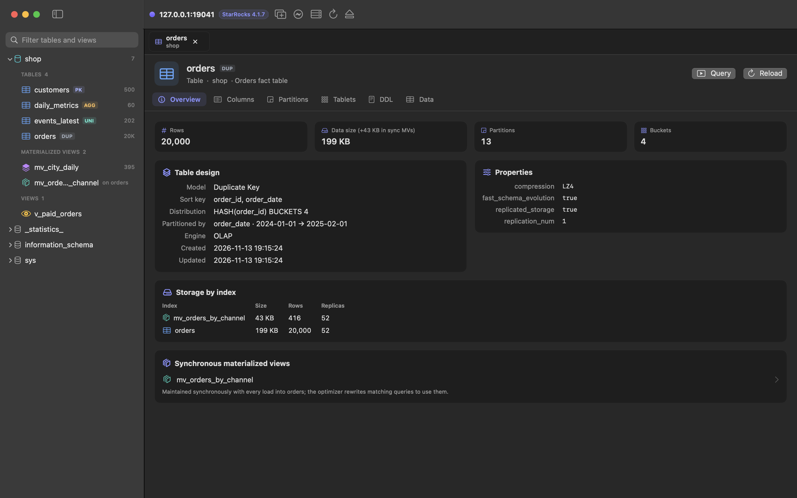
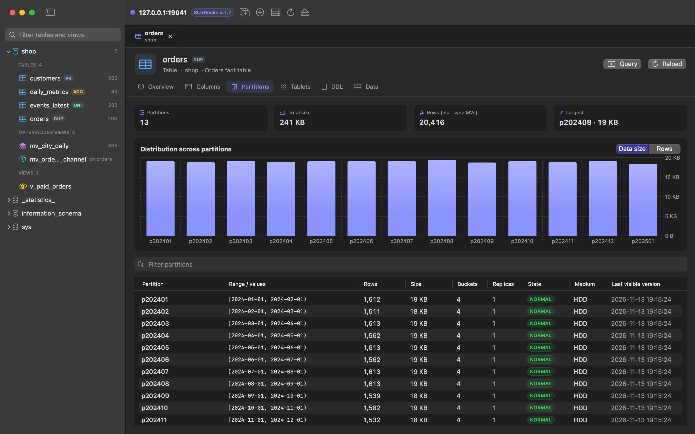
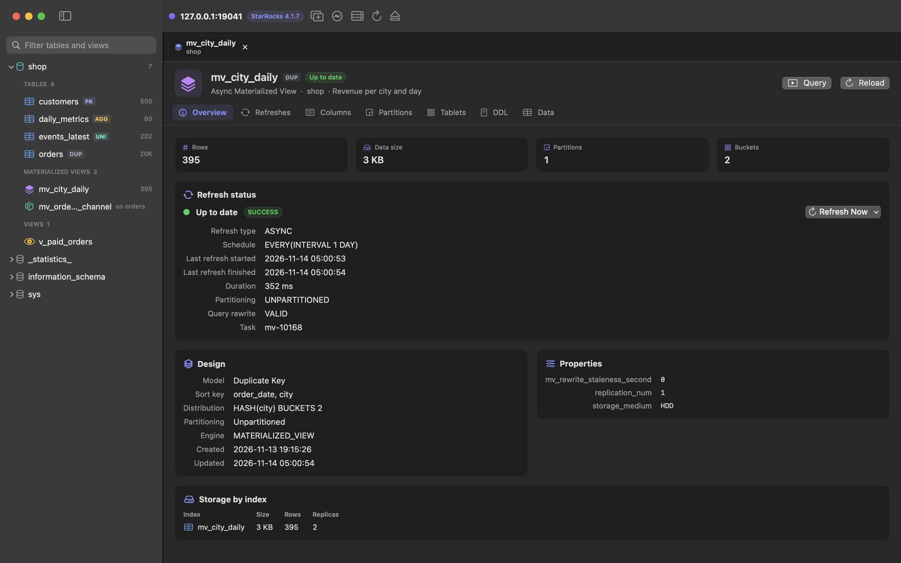
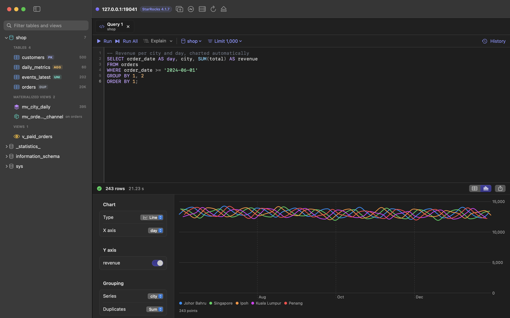
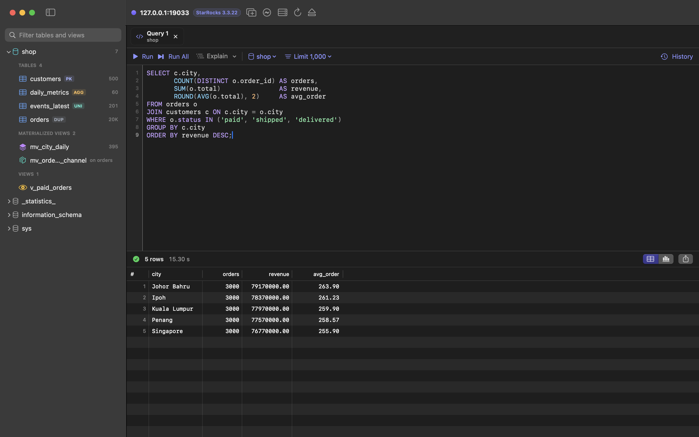
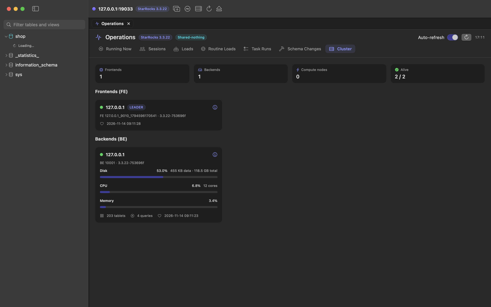

<p align="center">
  
</p>

<h1 align="center">CcinnStarRocks</h1>

<p align="center">
  <b>A fast, native macOS client built for StarRocks.</b><br>
  See partitions, tablets and data skew, keep materialized views healthy, watch what is running, and turn any query into a chart.
</p>

<p align="center">
  <a href="https://github.com/whiteCcinn/ccinnstarrocks/actions/workflows/ci.yml"></a>
  <a href="https://github.com/whiteCcinn/ccinnstarrocks/releases/latest"></a>
  
  
  
  <a href="LICENSE"></a>
</p>

<p align="center">
  English · <a href="README.zh-CN.md">简体中文</a>
</p>

<p align="center">
  
</p>

## Why CcinnStarRocks?

Generic SQL clients treat StarRocks as "just another MySQL". They show a flat list of tables and a query box. The things you actually need to run a StarRocks cluster are left to `SHOW PARTITIONS`, `SHOW TABLET`, `information_schema.task_runs` and a lot of copy-pasting:

- which tables are materialized views,
- whether those views are fresh,
- how a table is partitioned and bucketed,
- whether its tablets are skewed,
- which loads and refreshes are running right now.

CcinnStarRocks puts all of that one click away, in a native SwiftUI/AppKit app with its own pure-Swift MySQL protocol client. There is no Electron, no JDBC, no bundled runtime and no telemetry.

## Features

- **Know what every object is.** Tables, asynchronous materialized views, synchronous materialized views (rollups), views and external tables each get their own icon and colour. Tables carry their model badge (**DUP / AGG / UNI / PK**). Async MVs show refresh health in the sidebar. Sync MVs show their base table.
- **Table insights**
  - Model, keys, partitioning, distribution, buckets and properties.
  - Storage per index.
  - Partitions with range bounds, rows, size and a distribution chart.
  - **Tablets** with **skew detection** (tablets above 1.5× the average are flagged) and replicas per backend.
  - DDL and a data preview.
- **Materialized views**
  - Refresh state, schedule, last run, duration, query-rewrite status and errors.
  - Refresh history from task runs.
  - One-click refresh, force refresh, cancel and re-activate.
- **SQL workbench**
  - Syntax highlighting, and context-aware completion for:
    - catalogs, databases and tables,
    - columns through aliases, sub-queries and CTEs,
    - StarRocks functions.
  - Run the current statement, the selection or the whole script. Plain `SELECT`s get an automatic `LIMIT`.
  - `EXPLAIN` / `EXPLAIN COSTS`, and **real cancellation with `KILL QUERY`**.
  - Errors are underlined at their exact position. Searchable history.
  - CSV / TSV / `INSERT` export.
- **Charts from any query**
  - Results are charted automatically: a date column with numbers becomes a line chart, categories become bars, two categories become grouped bars, two numbers become a scatter plot.
  - Switch between bar, line, area, scatter and pie, pick axes, series and aggregation.
  - Large results are reduced to at most 2,000 points, off the main thread.
- **Operations**
  - **Running now** shows queries, loads, MV refreshes and tasks, routine loads and schema changes at a glance, with auto-refresh.
  - Sessions with *Kill Query / Kill Connection*.
  - Load jobs; routine loads with pause / resume / stop.
  - Task runs, schema-change jobs, and FE / BE / CN nodes with disk, CPU and memory usage.
- **Connectivity**
  - Multiple catalogs (internal and external).
  - SSH tunnels through your system OpenSSH (agent, key or password).
  - LDAP users via an opt-in `mysql_clear_password`.
  - Optional confirmation before statements that change data or schema.
- **Secure by default.** Passwords live in the macOS Keychain; nothing is collected or sent anywhere.

## Compatibility

| StarRocks | Deployment | Tested |
|---|---|---|
| 3.3 | shared-nothing | ✅ every release |
| 4.1 | shared-nothing | ✅ every release |
| 3.1 – 4.x | shared-nothing / shared-data | expected to work |

Metadata is read from `information_schema` (`tables_config`, `materialized_views`, `partitions_meta`, `task_runs`, `loads`, `routine_load_jobs`) with `SHOW` fallbacks. Every result is parsed **by column name**, so columns added or reordered in newer releases do not break the app. Features that need extra privileges, such as `ADMIN SHOW REPLICA DISTRIBUTION`, degrade with an explanation instead of failing. CcinnStarRocks runs on **macOS 14 Sonoma or later** (Apple silicon and Intel).

## Screenshots

| Partitions with range bounds and sizes | Tablets, skew detection and replicas per backend |
|---|---|
|  |  |
| **Asynchronous materialized view health** | **Charts generated from a query** |
|  |  |
| **SQL workbench with results grid** | **Cluster nodes** |
|  |  |

## Installation

1. Download `CcinnStarRocks-<version>.dmg` (or the `.zip`) from the [latest release](https://github.com/whiteCcinn/ccinnstarrocks/releases/latest).
2. Open the disk image and drag **CcinnStarRocks** into **Applications**.
3. The app is ad-hoc signed but not notarized. The first time, right-click the app and choose **Open**, or run:

   ```bash
   xattr -dr com.apple.quarantine /Applications/CcinnStarRocks.app
   ```

Each release lists SHA-256 checksums in `SHA256SUMS.txt`.

## Quick start

1. Click **New Connection** and enter the FE host and query port (default **9030**), user and password. Optionally add a default database or catalog, or an SSH tunnel.
2. Press **Test**, then **Save & Connect**.
3. Expand a database in the sidebar and pick a table or materialized view to see its partitions, tablets and refreshes. Or press **⌘T** for a SQL editor.

Useful shortcuts:

| Shortcut | Action |
|---|---|
| **⌘↩** | Run the selection or the current statement |
| **⇧⌘↩** | Run all statements |
| **⌘E** | Explain |
| **⌘.** | Cancel the running statement |
| **⌃Space** | Show completions |
| **⌘/** | Comment or uncomment lines |
| **⌘T** | New query |
| **⇧⌘R** | Refresh the catalog |
| **⇧⌘D** | Disconnect |

## Building from source

Requirements: macOS 14+, Xcode 16 or later (Swift 6).

```bash
git clone https://github.com/whiteCcinn/ccinnstarrocks.git
cd ccinnstarrocks
swift build                          # debug build
swift test --skip IntegrationTests   # unit tests
scripts/build-app.sh --open          # build dist/CcinnStarRocks.app and launch it
scripts/package-release.sh 1.0.0     # universal .app, .zip, .dmg and checksums in dist/
```

### Integration tests against real clusters

Docker is required. The script starts StarRocks 3.3 and 4.1 all-in-one containers and seeds a demo `shop` database. It contains one table of each model, monthly partitions, a view, and an async and a sync materialized view.

```bash
eval "$(scripts/sr-up.sh)"           # exports CCINNSR_IT_URIS
swift test --filter IntegrationTests
scripts/sr-down.sh
```

## Architecture

```
CcinnStarRocks (SwiftUI app)
 └─ CcinnStarRocksKit   profiles & Keychain, SQL lexer/splitter/auto-limit, completion, charts, export, skew, history
     └─ StarRocksKit    transport, connection actor, pool, sessions & KILL QUERY, SSH, metadata, insights, operations
         └─ MySQLWire   packet framing, handshake & auth plugins, OK/ERR/EOF, text result sets
```

- **One lexer for everything.** Highlighting, statement splitting, auto-limit, error positions and completion all share the same tokenizer, so they always agree.
- **Bounded and cancellable.** Result sets are capped, oversized results drop the connection instead of draining it, and cancelling a statement sends `KILL QUERY` on a separate connection.
- **Concurrency safety.** Connections, pools and sessions are Swift actors, and the project builds in Swift 6 strict-concurrency mode. Sorting, chart preparation and export run off the main thread.
- **Robust parsing.** Protocol parsing is bounds-checked and fuzz-tested; malformed packets raise errors instead of crashing.

## The ccinn series

Native macOS database and storage tools that share the same design, speed and care:

| App | What it is |
|---|---|
| [**CcinnMongo**](https://github.com/whiteCcinn/ccinnmongo) | Native MongoDB client for every server from 2.6 to 8.x, with the legacy `OP_QUERY` and the modern `OP_MSG` protocols. |
| **CcinnStarRocks** *(this project)* | Native StarRocks client. Covers partitions, tablets and skew, async and sync materialized views, running tasks, and SQL with completion and charts. |
| [**CcinnRedis**](https://github.com/whiteCcinn/ccinnredis) | Native Redis client for Redis 2.8 → 8.x and Valkey, in standalone, Sentinel, Cluster and proxy deployments. |
| [**CcinnBucket**](https://github.com/whiteCcinn/ccinnbucket) | Object storage browser for Amazon S3, S3-compatible services and Alibaba Cloud OSS. |

## Contributors

- [whiteCcinn](https://github.com/whiteCcinn)

<a href="https://github.com/whiteCcinn/ccinnstarrocks/graphs/contributors"></a>

## Star history

[](https://star-history.com/#whiteCcinn/ccinnstarrocks&Date)

## Contributing

Contributions are welcome! Please read [CONTRIBUTING.md](CONTRIBUTING.md), and report security issues privately as described in [SECURITY.md](SECURITY.md).

## License

[MIT](LICENSE) © 2026 whiteCcinn. StarRocks is a trademark of the Linux Foundation; this project is not affiliated with or endorsed by the StarRocks project or CelerData.
