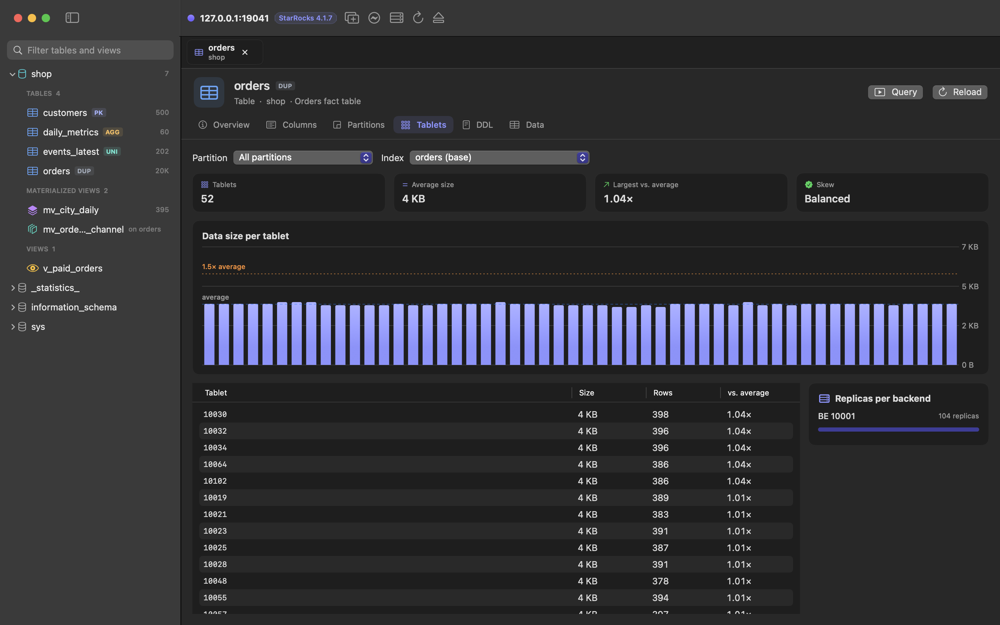

<p align="center">
  
</p>

<h1 align="center">CcinnStarRocks</h1>

<p align="center">
  <b>A fast, native macOS client built for StarRocks.</b><br>
  See partitions, tablets and data skew, keep materialized views healthy, watch what is running, and turn any query into a chart.
</p>

<p align="center">
  <a href="https://github.com/whiteCcinn/ccinnstarrocks/actions/workflows/ci.yml"></a>
  <a href="https://github.com/whiteCcinn/ccinnstarrocks/releases/latest"></a>
  
  
  
  <a href="LICENSE"></a>
</p>

<p align="center">
  English · <a href="README.zh-CN.md">简体中文</a>
</p>

<p align="center">
  
</p>

## Why CcinnStarRocks?

Generic SQL clients treat StarRocks as "just another MySQL". They show a flat list of tables and a query box. The things you actually need to run a StarRocks cluster are left to `SHOW PARTITIONS`, `SHOW TABLET`, `information_schema.task_runs` and a lot of copy-pasting:

- which tables are materialized views,
- whether those views are fresh,
- how a table is partitioned and bucketed,
- whether its tablets are skewed,
- which loads and refreshes are running right now.

CcinnStarRocks puts all of that one click away, in a native SwiftUI/AppKit app with its own pure-Swift MySQL protocol client. There is no Electron, no JDBC, no bundled runtime and no telemetry.

## Features

- **Know what every object is.** Tables, asynchronous materialized views, synchronous materialized views (rollups), views and external tables each get their own icon and colour. Tables carry their model badge (**DUP / AGG / UNI / PK**). Async MVs show refresh health in the sidebar. Sync MVs show their base table.
- **Table insights**
  - Model, keys, partitioning, distribution, buckets and properties.
  - Storage per index.
  - Partitions with range bounds, rows, size and a distribution chart.
  - **Tablets** with **skew detection** (tablets above 1.5× the average are flagged) and replicas per backend.
  - DDL and a data preview.
- **Materialized views**
  - Refresh state, schedule, last run, duration, query-rewrite status and errors.
  - Refresh history from task runs.
  - One-click refresh, force refresh, cancel and re-activate.
- **SQL workbench**
  - Syntax highlighting, and context-aware completion for:
    - catalogs, databases and tables,
    - columns through aliases, sub-queries and CTEs,
    - StarRocks functions.

    The table list opens as soon as you type a space after `FROM`, `JOIN`, `INTO`, `UPDATE` or `TABLE`, and the database list after `USE`.
  - Run the current statement, the selection or the whole script. Plain `SELECT`s get an automatic `LIMIT`.
  - `EXPLAIN` / `EXPLAIN COSTS`, and **real cancellation with `KILL QUERY`**.
  - Errors are underlined at their exact position, with the message next to the line. Unknown columns, tables and databases are found by name even when StarRocks reports no position. The marker follows your edits and disappears once you change the failing statement.
  - Unclosed quotes, comments and parentheses are flagged as you type.
  - **Format SQL** (⌥⌘L) lays out the selection or the whole script: one clause per line, one list item per line, indented subqueries and CASE. It only changes whitespace and the case of keywords that can never be names; names, functions, strings and comments are untouched, and the result is checked token by token before it replaces your text. Undo with ⌘Z.
  - Searchable history.
  - **Copy as** or **Export as** CSV, TSV, **Excel (.xlsx)** and SQL `INSERT`, one statement per row or multi-row:
    - Excel keeps values exact: integers show every digit, decimals their scale; IDs beyond Excel's 15-digit precision, and values with leading zeros, stay text. The header row is bold and frozen. Excel holds at most 1,048,575 rows; larger results are refused with a hint to use CSV.
    - Multi-row `INSERT`s list one row per line and start a new statement every 1,000 rows or about 1 MB, under the server's packet limit.
    - `INSERT`s target the table the rows came from (`db`.`table`, never the query's alias) when the result comes from a single table.
- **Charts from any query**
  - Results are charted automatically: a date column with numbers becomes a line chart, categories become bars, two categories become grouped bars, two numbers become a scatter plot.
  - Switch between bar, line, area, scatter and pie, pick axes, series and aggregation.
  - Large results are reduced to at most 2,000 points, off the main thread.
- **Operations**
  - **Running now** shows queries, loads, MV refreshes and tasks, routine loads and schema changes at a glance, with auto-refresh.
  - Sessions with *Kill Query / Kill Connection*.
  - **Loads** of every type, Stream Loads included:
    - search by keyword in any field or in one field (label, table, error, job id, …); the search runs on the server, so older jobs are found too;
    - filter by type and state, and optionally search `_statistics_.loads_history` for jobs the frontends no longer keep;
    - each load shows its client IP, transaction, bytes, timings and error tracking query;
    - internal `_statistics_` jobs are hidden unless you pick that database.
  - Routine loads with pause / resume / stop.
  - Task runs, schema-change jobs, and FE / BE / CN nodes with disk, CPU and memory usage.
  - **Configuration**: every variable and every FE and BE setting, with defaults. Values changed from the default and BE values that differ between nodes are marked. The view is read-only; **Edit in SQL Editor…** opens a pre-filled statement, and running it always asks for confirmation.
- **Connectivity**
  - **Multiple windows**, each with its own connection: File ▸ New CcinnStarRocks Window (⌘N), **New Window with This Connection** (⇧⌘N, also the toolbar's New Window button), or **Open in New Window** on a saved connection.
  - Multiple catalogs (internal and external).
  - SSH tunnels through your system OpenSSH (agent, key or password).
  - LDAP users via an opt-in `mysql_clear_password`.
  - Optional confirmation before statements that change data or schema. Statements that change cluster settings (`SET GLOBAL`, `ADMIN SET … CONFIG`, `UPDATE information_schema.be_configs`) are always confirmed.
- **AI access through MCP.** A built-in Model Context Protocol server lets Claude Code, Codex and Claude Desktop query the connections you opt in, read-only by default. See [MCP server](#mcp-server-let-ai-query-starrocks).
- **A knowledge base the AI builds once and reuses.** Per database: how tables relate (from declared constraints, view definitions, your query history, names, and the code your AI reads), notes, a glossary in any language, subject areas and ER diagrams, linked to your local projects. Later sessions answer from it instead of rediscovering the schema. See [Knowledge base](#knowledge-base).
- **Move to another Mac in one step.** File ▸ Export Settings and Knowledge… writes one file with your connections, the knowledge base and its linked projects, settings and, if you like, query history; passwords only when you seal them with a passphrase. Import shows what will change before anything is written, and can be undone. See [Moving to another Mac](#moving-to-another-mac).
- **Secure by default.** Passwords live in the macOS Keychain; nothing is collected or sent anywhere unless you enable AI access.

## Compatibility

| StarRocks | Deployment | Tested |
|---|---|---|
| 3.3 | shared-nothing | ✅ every release |
| 4.1 | shared-nothing | ✅ every release |
| 3.1 – 4.x | shared-nothing / shared-data | expected to work |

Metadata is read from `information_schema` (`tables_config`, `materialized_views`, `partitions_meta`, `task_runs`, `loads`, `routine_load_jobs`, `be_configs`, `global_variables`, `verbose_session_variables`) and `_statistics_.loads_history` with `SHOW` fallbacks. Every result is parsed **by column name**, so columns added or reordered in newer releases do not break the app. Features that need extra privileges, such as `ADMIN SHOW REPLICA DISTRIBUTION`, degrade with an explanation instead of failing. CcinnStarRocks runs on **macOS 14 Sonoma or later** (Apple silicon and Intel).

## Screenshots

| Partitions with range bounds and sizes | Tablets, skew detection and replicas per backend |
|---|---|
|  |  |
| **Asynchronous materialized view health** | **Charts generated from a query** |
|  |  |
| **SQL workbench with results grid** | **Cluster nodes** |
|  |  |

## Installation

1. Download `CcinnStarRocks-<version>.dmg` (or the `.zip`) from the [latest release](https://github.com/whiteCcinn/ccinnstarrocks/releases/latest).
2. Open the disk image and drag **CcinnStarRocks** into **Applications**.
3. The app is ad-hoc signed but not notarized. The first time, right-click the app and choose **Open**, or run:

   ```bash
   xattr -dr com.apple.quarantine /Applications/CcinnStarRocks.app
   ```

Each release lists SHA-256 checksums in `SHA256SUMS.txt`.

### Updating

Choose **CcinnStarRocks → Check for Updates…**. If a newer release exists, CcinnStarRocks shows what's new. **Download & Open** saves the disk image to your Downloads folder, checks it against the release's `SHA256SUMS.txt`, and opens it. Quit CcinnStarRocks, then drag the new version onto **Applications**.

CcinnStarRocks also checks quietly once a day; turn this off in **Settings → General → Updates**. The check contacts only GitHub's public releases API, and you can **Skip This Version**.

The project page, release notes and issue tracker are also in the **Help** menu and the About window.

## Quick start

1. Click **New Connection** and enter the FE host and query port (default **9030**), user and password. Optionally add a default database or catalog, or an SSH tunnel.
2. Press **Test**, then **Save & Connect**.
3. Expand a database in the sidebar and pick a table or materialized view to see its partitions, tablets and refreshes. Or press **⌘T** for a SQL editor.

Useful shortcuts:

| Shortcut | Action |
|---|---|
| **⌘↩** | Run the selection or the current statement |
| **⇧⌘↩** | Run all statements |
| **⌘E** | Explain |
| **⌘.** | Cancel the running statement |
| **⌃Space** | Show completions |
| **⌘/** | Comment or uncomment lines |
| **⌥⌘L** | Format SQL (selection or whole script) |
| **⌘T** | New query (each tab has its own session and runs independently) |
| **⌘N** | New window (another cluster, or the same one) |
| **⇧⌘N** | New window with this connection |
| **⇧⌘R** | Refresh the catalog |
| **⇧⌘D** | Disconnect |

## Moving to another Mac

**File ▸ Export Settings and Knowledge…** (also in **Settings → General → Backup**) writes a single `.ccinnstarrocks-backup` file, readable only by you:

| Part | Included | Notes |
|---|---|---|
| Connections | always | host, port, user, catalog, SSH route, AI access; never SSH key files |
| Knowledge and linked projects | on | relationships, notes, glossary, subject areas; project paths under your home are written `~/…` |
| App settings | on | appearance, automatic `LIMIT`, SQL formatting, update checks; never window positions |
| Query history | off | statements with passwords removed; they may still contain table names and literal values |
| Passwords and SSH secrets | off | only with a passphrase (at least 12 characters, entered twice) |

**Passwords** are encrypted with AES-256-GCM under a key derived from your passphrase (PBKDF2-HMAC-SHA256, 600,000 iterations), and the passphrase also authenticates the whole file. It is never stored: lose it and the passwords cannot be recovered, but everything else still imports.

On the other Mac, **File ▸ Import Settings and Knowledge…** opens the file, asks for the passphrase (or imports without passwords), and shows a preview before writing anything:

- **Connections**: new, unchanged, or different from the one here. For a difference choose *Keep mine*, *Use imported* or *Keep both*; the newer edit is suggested. Changes that weaken security are highlighted (another server or SSH route, more AI access, clear-text passwords, no confirmation before changes, an administrator-account opt-in), and from a file without a passphrase, which anyone could have written, they keep your current setting unless you choose otherwise. AI access to an administrator account is only ever taken from a passphrase-verified file.
- **Knowledge** merges item by item: nothing here is lost, deletions recorded in the backup are applied, and the newer copy of a note or term wins.
- **Projects** that are not on this Mac are marked. Point one at a folder, or move them all at once (`/Volumes/Work/code` → `~/code`).
- **Settings** show old → new, each one optional; **history** shows how many statements each connection gains.

Importing first saves your current setup (without passwords) to `Backups/` in the app's data folder, keeping the last five. The report offers **Restore Pre-Import Snapshot**, which undoes exactly what the import wrote: connections it added or replaced, the passwords it added, knowledge, history entries and settings. Connections you add or change and queries you run afterwards are kept. A password the import replaced cannot be put back; if its connection goes back to another server, the imported password is removed rather than sent there, and you enter it again. A restore that stops part-way can be run again. Importing the same file again changes nothing. After an import that changed connections, restart the MCP server in your AI clients (`/mcp` in Claude Code) so they see them.

## MCP server: let AI query StarRocks

CcinnStarRocks has a built-in **Model Context Protocol** server. AI assistants such as **Claude Code**, **Codex**, **Claude Desktop** or Cursor can use it to explore your clusters and run queries through your saved connections.

1. Open a connection in CcinnStarRocks and set **AI access (MCP)** to **Read-only** or **Read & write**. Connections are off by default.
2. Register the server. **Settings → MCP** shows these snippets with the right path, ready to copy:

   ```bash
   # Claude Code
   claude mcp add ccinnstarrocks -- /Applications/CcinnStarRocks.app/Contents/MacOS/CcinnStarRocks mcp
   ```

   ```toml
   # Codex (~/.codex/config.toml)
   [mcp_servers.ccinnstarrocks]
   command = "/Applications/CcinnStarRocks.app/Contents/MacOS/CcinnStarRocks"
   args = ["mcp"]
   ```

   ```json
   // Claude Desktop (claude_desktop_config.json) and other JSON-configured clients
   { "mcpServers": { "ccinnstarrocks": { "command": "/Applications/CcinnStarRocks.app/Contents/MacOS/CcinnStarRocks", "args": ["mcp"] } } }
   ```

3. Ask questions such as *"Which materialized views in `shop` failed their last refresh?"* or *"Is `shop.orders` skewed, and which city has the most revenue?"*

**Tools**

| Group | Tools |
|---|---|
| Connections | `list_connections` |
| Catalog | `list_catalogs`, `list_databases`, `list_tables`, `describe_table` |
| Table insights | `get_partitions`, `analyze_tablet_skew`, `get_materialized_view` |
| Cluster | `get_running_tasks`, `list_cluster_nodes` |
| SQL | `run_query`, `explain_query`, and `execute_statement` (read & write connections only) |
| Knowledge (read) | `list_knowledge`, `knowledge_overview`, `search_knowledge`, `explain_table`, `find_join_path`, `er_diagram`, `refresh_knowledge` |
| Knowledge (write) | `link_project`, `add_notes`, `add_relationships`, `define_terms`, `define_subject_area`, `remove_knowledge` |

Prompts: `build_knowledge` (analyse this project and a database, and record what it finds) and `answer_with_knowledge` (look things up before writing SQL). Claude Code offers them as `/mcp__ccinnstarrocks__build_knowledge`.

`list_tables` reports each object's kind (table, async or sync materialized view, view, external table), its model and the refresh health of materialized views.

### Knowledge base

StarRocks has no foreign keys, so the joins that matter (`report_adx_hour.dsp_id` → `dsp.id`) live in people's heads, in code and in query history. The knowledge base keeps them, with everything else an AI needs to answer quickly and correctly, and every AI session reuses it.

- **No AI inside the app.** CcinnStarRocks reads metadata (never rows) and infers what it can; your AI client, which has the repository open, does the reading of code and writes back what it learns through the knowledge tools.
- **One knowledge base per database**, keyed by the cluster's endpoint (through the SSH bastion when tunnelled), shared by every connection that reaches it, and linked to any number of local projects. A session started in a linked project finds it with `list_knowledge`.
- **Relationships carry their evidence**: declared `foreign_key_constraints`, joins inside view and materialized-view definitions, joins in the editor's query history, column and table names, code references (path, line, symbol) and AI assertions. Confidence (0–100) is computed from the evidence; only what you confirmed or what a constraint declares is a fact, everything else is labelled *inferred*. Your Confirm or Reject in the app always wins.
- **Freshness.** Each table's structure has a fingerprint. When a table changes, notes and relationships written against it are marked stale until someone confirms them again; dropped tables are kept until you prune them.
- **Answers, not just pictures.** `find_join_path` returns the join chain with its `ON` conditions, a SQL skeleton and a warning when rows would multiply (two fact tables through one dimension). `explain_table` adds hints such as "filter on the partition key `dt`" and "AGG model: value columns are pre-aggregated". `er_diagram` draws a Mermaid diagram of one subject area, a list of tables, the tables around one, or a prefix — never one diagram of hundreds of tables.
- **In the app**: right-click a database → **Knowledge**: refresh, review inferred relationships (Confirm / Reject), notes and glossary, the diagram of a subject area (Copy Mermaid), and linked projects (Link, Remap, Unlink).
- Files live in `~/Library/Application Support/CcinnStarRocks/Knowledge/` (owner-only); the app and the `mcp` process share them safely.

**Safety**

- Passwords stay in the Keychain and are never shown to the AI.
- Only connections you enabled are visible.
- `run_query` accepts a single read-only statement (`SELECT`, `WITH`, `SHOW`, `DESC`, `EXPLAIN`). The app checks this with its own SQL lexer; it does not trust the model. The check runs on the exact text that is sent, after the automatic `LIMIT`.
- AI connections always use the StarRocks SQL dialect, even when the account or cluster defaults to `trino`, where `"…"` is a name rather than a string. If the dialect cannot be set and confirmed, the connection is refused.
- **Administrator accounts are refused for read-only access.** No check on SQL text can stop an administrator, so read-only AI access refuses accounts that hold `root`, `cluster_admin`, `user_admin` or `db_admin`, system privileges, `IMPERSONATE`, grant options, or write privileges on all databases. It follows every role the account holds and checks on every call. Use an account with only the privileges the AI needs, or allow one in **Settings → MCP → Allow privileged account** (per connection, off by default).
- **Other sessions' SQL, credentials and server files stay out of reach.** The AI cannot read task and query history, load and pipe properties, backend logs or configuration, `SHOW PROCESSLIST`, or the audit log. Names holding a letter StarRocks may read as an ASCII letter (`ı` is I, `ſ` is S there) are refused, so `fıles(` can't stand in for `FILES(`. `get_running_tasks` shows running statements with every literal replaced by `?`.
- **AI queries call only reviewed built-in functions.** User-defined functions are refused, and so are functions that read files, other users' data or the network. Among them: `FILES()` reads any path the backends can reach, their own disks included; `ai_query()` (4.1) makes the backends send query data to any URL; `lookup_string()` and `get_query_dump()` show tables the account may not read. Functions that a new StarRocks version adds are refused until they are reviewed. A few rare spellings are refused because they could hide a call: write `INTERVAL 1 DAY` rather than `INTERVAL (1) DAY` outside a function's arguments, and `QUALIFY row_number() OVER (…) = 1` without parentheses around the window function.
- User-defined functions (Java, Python) run whatever their author wrote, and a check cannot see inside them. Read-only queries refuse them, but `execute_statement` (read & write connections) and views can still call them, so only give the AI an account that cannot call functions you do not trust.
- Results are capped at 1,000 rows (200 by default) and about 256 KB. Statements time out after 30 s by default.
- Cancelling a request in the AI client sends `KILL QUERY`.
- `execute_statement` never changes cluster settings (`SET GLOBAL`, `ADMIN SET … CONFIG`, `UPDATE information_schema.be_configs`): those need a confirmation in the app.
- `--read-only` caps every connection at read-only; `--profile <name>` picks the default connection.
- Every call is logged to `~/Library/Application Support/CcinnStarRocks/mcp-audit.jsonl`, with the AI client's name and, for knowledge writes, what changed.
- **Knowledge follows the account.** An AI sees knowledge only for connections with AI access, and only the databases and tables that connection's account can see, even when the knowledge was built through a more privileged connection. A refresh an AI runs through such an account updates what it sees and leaves the rest as it was; only a Refresh in the app marks tables dropped.
- **Knowledge holds no data.** No rows, sample values, DDL or code are stored: structure, relationships with evidence (paths, lines, symbols, SQL digests with literals replaced) and notes. Database comments, notes and glossary text reach the AI marked as untrusted data, not instructions.
- **Who may write.** AI writes only local knowledge files, never the cluster, so it is allowed on read-only connections; turn it off per connection with **Settings → MCP → AI may write knowledge**, or for the whole server with `--no-knowledge-writes`. AI can never change or remove what you wrote, confirmed or rejected.

## Building from source

Requirements: macOS 14+, Xcode 16 or later (Swift 6).

```bash
git clone https://github.com/whiteCcinn/ccinnstarrocks.git
cd ccinnstarrocks
swift build                          # debug build
swift test --skip IntegrationTests   # unit tests
scripts/build-app.sh --open          # build dist/CcinnStarRocks.app and launch it
scripts/package-release.sh 1.0.0     # universal .app, .zip, .dmg and checksums in dist/
```

### Integration tests against real clusters

Docker is required. The script starts StarRocks 3.3 and 4.1 all-in-one containers and seeds a demo `shop` database. It contains one table of each model, monthly partitions, a view, and an async and a sync materialized view.

```bash
eval "$(scripts/sr-up.sh)"           # exports CCINNSR_IT_URIS
swift test --filter IntegrationTests
scripts/sr-down.sh
```

## Architecture

```
CcinnStarRocks (SwiftUI app)
 └─ CcinnStarRocksKit   profiles & Keychain, SQL lexer/splitter/auto-limit, completion, charts, export, skew, history
     └─ StarRocksKit    transport, connection actor, pool, sessions & KILL QUERY, SSH, metadata, insights, operations
         └─ MySQLWire   packet framing, handshake & auth plugins, OK/ERR/EOF, text result sets
```

- **One lexer for everything.** Highlighting, statement splitting, auto-limit, error positions and completion all share the same tokenizer, so they always agree.
- **Bounded and cancellable.** Result sets are capped, oversized results drop the connection instead of draining it, and cancelling a statement sends `KILL QUERY` on a separate connection.
- **Concurrency safety.** Connections, pools and sessions are Swift actors, and the project builds in Swift 6 strict-concurrency mode. Sorting, chart preparation and export run off the main thread.
- **Robust parsing.** Protocol parsing is bounds-checked and fuzz-tested; malformed packets raise errors instead of crashing.

## The ccinn series

Native macOS database and storage tools that share the same design, speed and care:

| App | What it is |
|---|---|
| [**CcinnMongo**](https://github.com/whiteCcinn/ccinnmongo) | Native MongoDB client for every server from 2.6 to 8.x, with the legacy `OP_QUERY` and the modern `OP_MSG` protocols. |
| **CcinnStarRocks** *(this project)* | Native StarRocks client. Covers partitions, tablets and skew, async and sync materialized views, running tasks, and SQL with completion and charts. |
| [**CcinnRedis**](https://github.com/whiteCcinn/ccinnredis) | Native Redis client for Redis 2.8 → 8.x and Valkey, in standalone, Sentinel, Cluster and proxy deployments. |
| [**CcinnBucket**](https://github.com/whiteCcinn/ccinnbucket) | Object storage browser for Amazon S3, S3-compatible services and Alibaba Cloud OSS. |
| [**CcinnMysql**](https://github.com/whiteCcinn/ccinnmysql) | Native MySQL, MariaDB and Percona client for 5.5 → 9.x: TLS and every auth plugin, InnoDB locks, top statements, replication, visual EXPLAIN and safe inline editing. |
| [**CcinnPsql**](https://github.com/whiteCcinn/ccinnpsql) | Native PostgreSQL client for 9.6 → 18: blocking trees, index and bloat insights, replication and slots, visual EXPLAIN ANALYZE, PgBouncer and Pgpool awareness. |
| [**CcinnClickHouse**](https://github.com/whiteCcinn/ccinnclickhouse) | Native ClickHouse client for 22.8 → 26.x: engine families, parts and compression, merges, mutations, replication, query-log analysis and cluster topology. |

## Contributors

- [whiteCcinn](https://github.com/whiteCcinn)

<a href="https://github.com/whiteCcinn/ccinnstarrocks/graphs/contributors"></a>

## Star history

[](https://star-history.com/#whiteCcinn/ccinnstarrocks&Date)

## Contributing

Contributions are welcome! Please read [CONTRIBUTING.md](CONTRIBUTING.md), and report security issues privately as described in [SECURITY.md](SECURITY.md).

## License

[MIT](LICENSE) © 2026 whiteCcinn. StarRocks is a trademark of the Linux Foundation; this project is not affiliated with or endorsed by the StarRocks project or CelerData.
