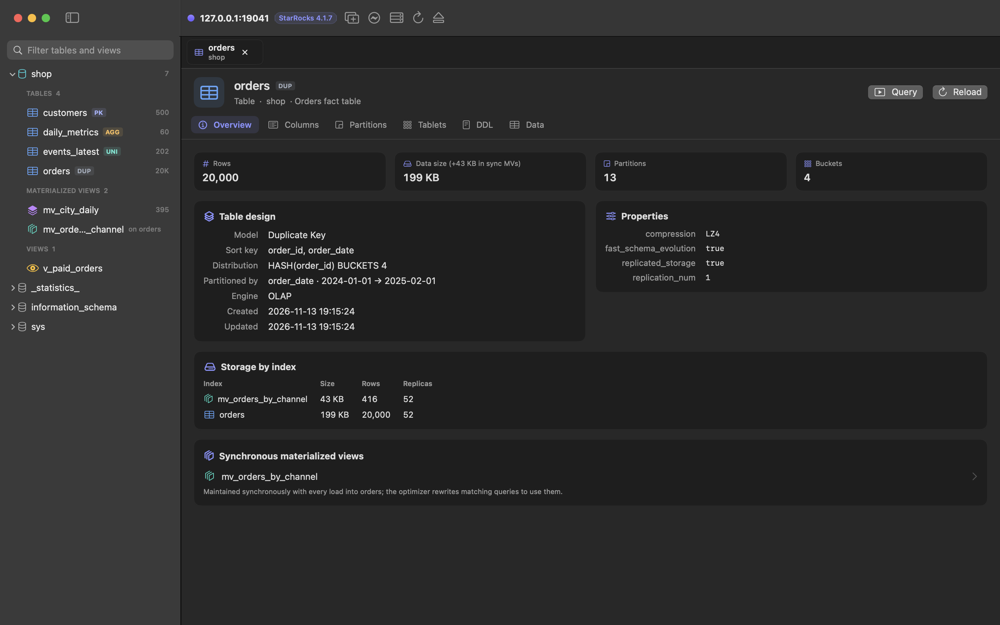
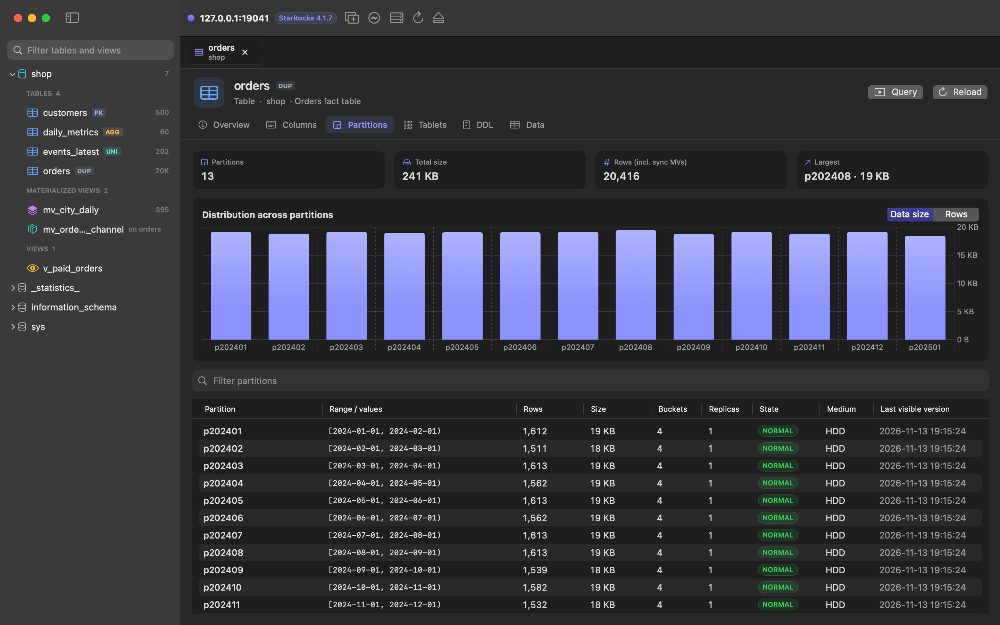
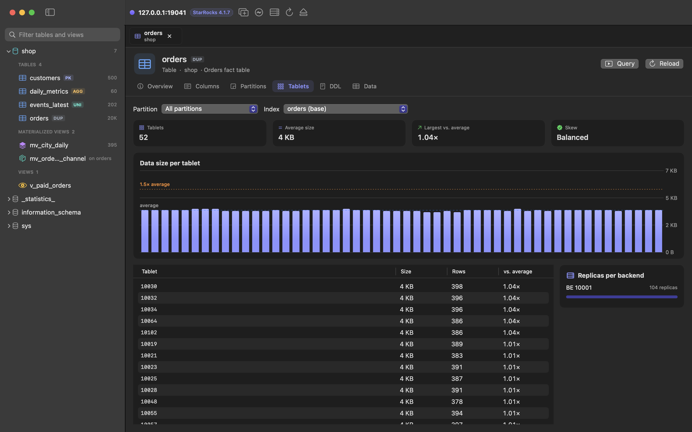
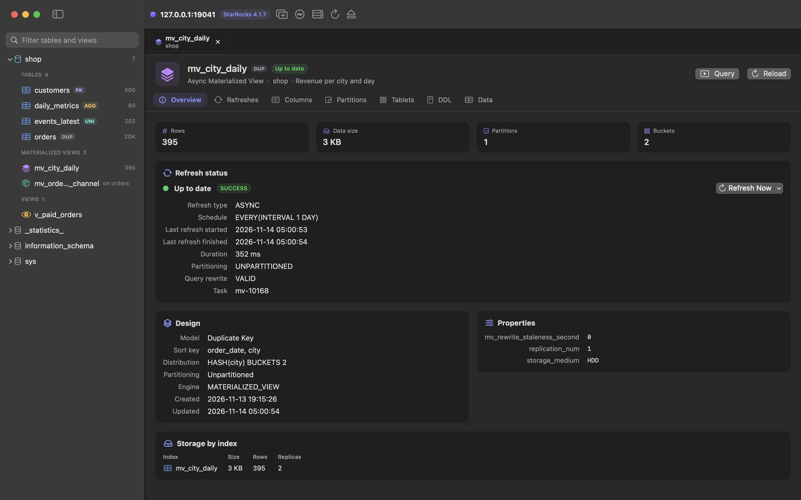
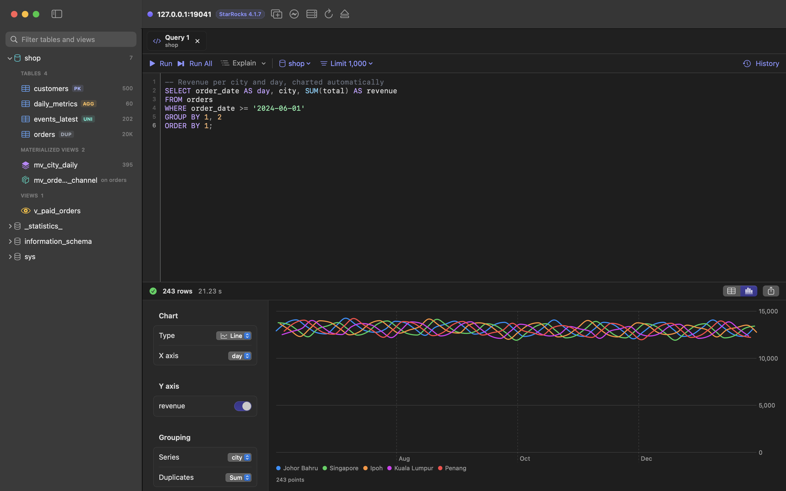
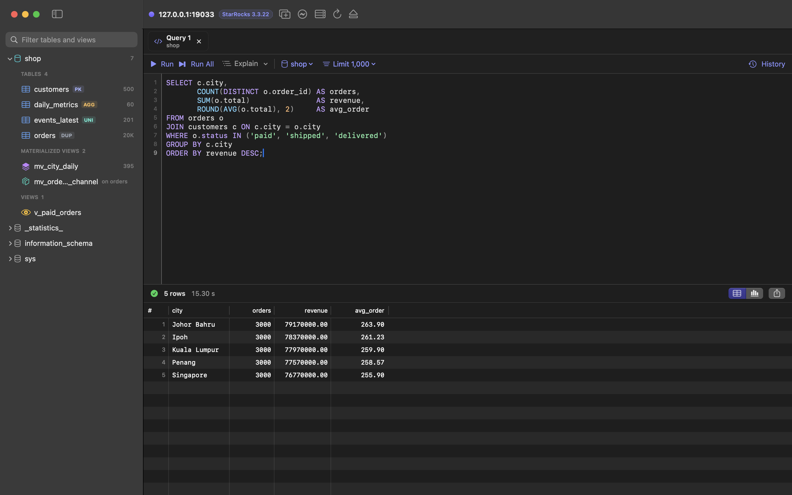
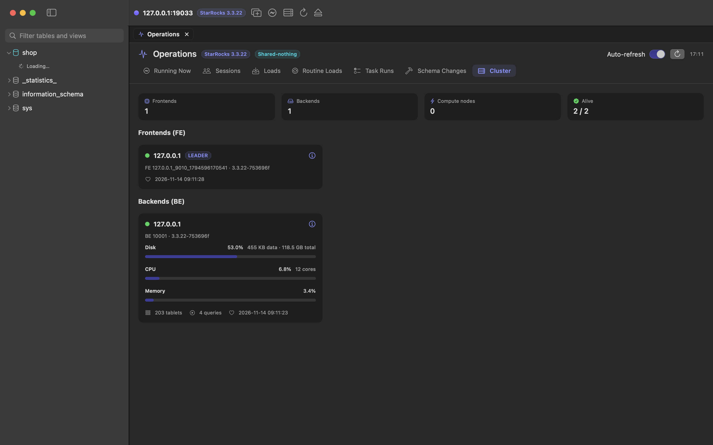

<p align="center">
  
</p>

<h1 align="center">CcinnStarRocks</h1>

<p align="center">
  <b>为 StarRocks 打造的快速、原生 macOS 客户端。</b><br>
  一眼看清分区、Tablet 与数据倾斜，掌握物化视图的健康状况与正在运行的任务，并把任意查询直接变成图表。
</p>

<p align="center">
  <a href="https://github.com/whiteCcinn/ccinnstarrocks/actions/workflows/ci.yml"></a>
  <a href="https://github.com/whiteCcinn/ccinnstarrocks/releases/latest"></a>
  
  
  
  <a href="LICENSE"></a>
</p>

<p align="center">
  <a href="README.md">English</a> · 简体中文
</p>

<p align="center">
  
</p>

## 为什么选择 CcinnStarRocks？

通用 SQL 客户端把 StarRocks 当成"另一个 MySQL"：一个扁平的表列表加一个查询框。而真正运维 StarRocks 集群时最需要的信息，仍然只能靠 `SHOW PARTITIONS`、`SHOW TABLET`、`information_schema.task_runs` 和大量复制粘贴来拼凑：

- 哪些表其实是物化视图；
- 这些物化视图是否是最新的；
- 表是如何分区、如何分桶的；
- Tablet 是否存在倾斜；
- 此刻有哪些导入和刷新正在运行。

CcinnStarRocks 把这些信息都放在一次点击之内。它是原生的 SwiftUI/AppKit 应用，内置纯 Swift 实现的 MySQL 协议客户端。没有 Electron，没有 JDBC，不捆绑运行时，也不收集任何数据。

## 功能特性

- **一眼识别每个对象**：表、异步物化视图、同步物化视图（Rollup）、视图、外表各有专属图标和颜色。表带有数据模型徽标（**DUP / AGG / UNI / PK**），异步物化视图在侧边栏直接显示刷新健康状态，同步物化视图显示其基表。
- **表洞察**
  - 数据模型、键、分区、分布、分桶与属性；
  - 各索引的存储占用；
  - 分区的范围边界、行数、大小，以及分布图表；
  - **Tablet** 列表、**倾斜检测**（超过平均值 1.5 倍的 Tablet 会被标出）以及各 BE 的副本分布；
  - DDL 与数据预览。
- **物化视图**
  - 刷新状态、调度策略、最近一次运行、耗时、查询改写状态与错误信息；
  - 基于 task runs 的刷新历史；
  - 一键刷新、强制刷新、取消刷新、重新激活。
- **SQL 工作台**
  - 语法高亮，以及上下文感知补全，覆盖：
    - Catalog、数据库、表；
    - 通过别名、子查询和 CTE 解析出的列；
    - StarRocks 函数。

    在 `FROM`、`JOIN`、`INTO`、`UPDATE` 或 `TABLE` 后输入空格即弹出表列表，`USE` 后弹出数据库列表。
  - 可执行当前语句、选中内容或整个脚本，普通 `SELECT` 会自动加上 `LIMIT`。
  - `EXPLAIN` / `EXPLAIN COSTS`，以及**基于 `KILL QUERY` 的真正取消**。
  - 错误会在精确位置下划线标出，并在该行末尾显示错误信息；即使 StarRocks 没有返回位置，也会按名称定位未知的列、表和数据库；标记会随编辑移动，修改出错语句后自动消失。
  - 输入时即时提示未闭合的引号、注释和括号。
  - **格式化 SQL**（⌥⌘L）：格式化选中内容或整个脚本，每个子句一行、列表每项一行，子查询和 CASE 自动缩进。只改动空白，以及不可能用作名称的关键字的大小写；名称、函数、字符串和注释原样保留；替换前会逐个 token 校验结果，可用 ⌘Z 撤销。
  - 历史记录可搜索。
  - 结果可**复制为**或**导出为** CSV、TSV、**Excel（.xlsx）**以及 SQL `INSERT`（每行一条，或多行合并为一条）：
    - Excel 保持数值精确：整数显示全部位数，小数按列的精度显示；超过 Excel 15 位精度的 ID 和带前导零的值保留为文本。表头加粗并冻结。Excel 最多容纳 1,048,575 行，更大的结果会提示改用 CSV。
    - 多行 `INSERT` 每行数据占一行，每 1,000 行或约 1 MB 另起一条语句，不超过服务器的包大小限制。
    - 结果来自单张表时，`INSERT` 的目标是数据来源表（`库`.`表`，而不是查询里的别名）。
- **任意查询一键成图**
  - 自动推荐图表：日期列配数值生成折线图，分类配数值生成柱状图，两个分类生成分组柱状图，两个数值生成散点图。
  - 可切换柱状、折线、面积、散点、饼图，自选坐标轴、系列与聚合方式。
  - 大结果集在后台线程中缩减到最多 2,000 个点。
- **运维视图**
  - **正在运行**：一屏汇总查询、导入、物化视图刷新与任务、Routine Load、Schema Change，并自动刷新。
  - 会话列表，可*终止查询 / 终止连接*。
  - **导入任务**（包括 Stream Load）：
    - 可在任意字段或指定字段（Label、表、错误信息、Job ID 等）中按关键字搜索，搜索在服务端执行，较早的任务也能找到；
    - 可按类型和状态筛选，并可同时搜索 `_statistics_.loads_history`，找回 FE 已不再保留的任务；
    - 每个导入都会显示客户端 IP、事务、字节数、各阶段时间以及错误追踪查询；
    - 默认隐藏 `_statistics_` 的内部统计任务，选择该数据库后才会显示。
  - Routine Load 支持暂停 / 恢复 / 停止。
  - 任务运行记录、Schema Change 任务，以及 FE / BE / CN 节点的磁盘、CPU 与内存使用率。
  - **配置**：所有变量以及所有 FE、BE 配置项和默认值；会标出与默认值不同的配置，以及在各 BE 节点之间取值不一致的配置。该视图只读，**在 SQL 编辑器中修改…** 只会打开预填好的语句，执行前一定会二次确认。
- **连接能力**
  - **多窗口**，每个窗口使用独立连接：文件 ▸ New CcinnStarRocks Window（⌘N），**用当前连接新建窗口**（⇧⌘N，也可点工具栏的“新建窗口”按钮），或在已保存的连接上选择**在新窗口中打开**。
  - 多 Catalog（内部与外部）。
  - 通过系统 OpenSSH 建立 SSH 隧道（agent、密钥或密码）。
  - 可选启用 `mysql_clear_password` 以支持 LDAP 用户。
  - 可选在执行修改数据或结构的语句前二次确认；修改集群配置的语句（`SET GLOBAL`、`ADMIN SET … CONFIG`、`UPDATE information_schema.be_configs`）始终需要二次确认。
- **通过 MCP 接入 AI**：内置 Model Context Protocol 服务，让 Claude Code、Codex、Claude Desktop 查询你授权的连接（默认只读），详见 [MCP 服务](#mcp-服务让-ai-查询-starrocks)。
- **AI 构建一次、反复复用的知识库**：按数据库记录表与表之间的关系（来自声明的约束、视图定义、你的查询历史、命名，以及 AI 读到的代码）、注释说明、任意语言的术语表、主题域与 ER 图，并关联到本地项目。之后的会话直接查知识库，不必重新摸索表结构。详见[知识库](#知识库)。
- **默认安全**：密码保存在 macOS 钥匙串中；除非启用 AI 访问，不会收集或发送任何数据。

## 兼容性

| StarRocks | 部署形态 | 测试情况 |
|---|---|---|
| 3.3 | 存算一体 | ✅ 每个版本均测试 |
| 4.1 | 存算一体 | ✅ 每个版本均测试 |
| 3.1 – 4.x | 存算一体 / 存算分离 | 预期可用 |

元数据优先读取 `information_schema`（`tables_config`、`materialized_views`、`partitions_meta`、`task_runs`、`loads`、`routine_load_jobs`、`be_configs`、`global_variables`、`verbose_session_variables`）与 `_statistics_.loads_history`，不可用时回退到 `SHOW` 命令。所有结果都**按列名解析**，新版本增加或调整列顺序不会影响使用。需要额外权限的功能（如 `ADMIN SHOW REPLICA DISTRIBUTION`）会给出说明并优雅降级，而不是直接报错。CcinnStarRocks 支持 **macOS 14 Sonoma 及以上**（Apple 芯片与 Intel）。

## 截图

| 分区：范围边界与大小 | Tablet：倾斜检测与各 BE 副本分布 |
|---|---|
|  |  |
| **异步物化视图健康状态** | **由查询生成的图表** |
|  |  |
| **SQL 工作台与结果表格** | **集群节点** |
|  |  |

## 安装

1. 从 [最新 Release](https://github.com/whiteCcinn/ccinnstarrocks/releases/latest) 下载 `CcinnStarRocks-<版本>.dmg`（或 `.zip`）。
2. 打开磁盘映像，把 **CcinnStarRocks** 拖入 **应用程序**。
3. 应用使用 ad-hoc 签名，未经过 Apple 公证。首次打开时请右键点击应用并选择**打开**，或执行：

   ```bash
   xattr -dr com.apple.quarantine /Applications/CcinnStarRocks.app
   ```

每个 Release 都附带 `SHA256SUMS.txt` 校验和。

### 更新

选择 **CcinnStarRocks → 检查更新…（Check for Updates…）**。如果有新版本，CcinnStarRocks 会显示更新内容。**下载并打开（Download & Open）** 会把磁盘映像保存到“下载”文件夹，按该版本的 `SHA256SUMS.txt` 校验后再打开。退出 CcinnStarRocks，然后把新版本拖到 **应用程序** 文件夹即可。

CcinnStarRocks 每天也会在后台自动检查一次，可以在 **设置 → 通用 → 更新** 中关闭。检查只访问 GitHub 的公开 Releases API，也可以选择 **跳过此版本（Skip This Version）**。

项目主页、发布说明和问题反馈入口也在 **帮助** 菜单和“关于”窗口中。

## 快速开始

1. 点击**新建连接**，填写 FE 地址与查询端口（默认 **9030**）、用户名和密码；可选填默认数据库 / Catalog，或配置 SSH 隧道。
2. 点击**测试**，然后**保存并连接**。
3. 在侧边栏展开数据库，选择表或物化视图即可查看分区、Tablet 与刷新情况；也可以按 **⌘T** 打开 SQL 编辑器。

常用快捷键：

| 快捷键 | 作用 |
|---|---|
| **⌘↩** | 执行选中内容或当前语句 |
| **⇧⌘↩** | 执行全部语句 |
| **⌘E** | 查看执行计划 |
| **⌘.** | 取消正在执行的语句 |
| **⌃Space** | 显示补全 |
| **⌘/** | 注释 / 取消注释所选行 |
| **⌥⌘L** | 格式化 SQL（选中内容或整个脚本） |
| **⌘T** | 新建查询（每个标签页使用独立会话，可同时执行） |
| **⌘N** | 新建窗口（连接另一个集群，或同一集群） |
| **⇧⌘N** | 用当前连接新建窗口 |
| **⇧⌘R** | 刷新 Catalog |
| **⇧⌘D** | 断开连接 |

## MCP 服务：让 AI 查询 StarRocks

CcinnStarRocks 内置 **Model Context Protocol** 服务，**Claude Code**、**Codex**、**Claude Desktop**、Cursor 等 AI 助手可以通过你保存的连接探索集群并执行查询。

1. 在 CcinnStarRocks 中打开连接，把 **AI 访问 (MCP)** 设为**只读**或**读写**（默认关闭）。
2. 注册服务。**设置 → MCP** 中提供了带正确路径、可直接复制的配置：

   ```bash
   # Claude Code
   claude mcp add ccinnstarrocks -- /Applications/CcinnStarRocks.app/Contents/MacOS/CcinnStarRocks mcp
   ```

   ```toml
   # Codex（~/.codex/config.toml）
   [mcp_servers.ccinnstarrocks]
   command = "/Applications/CcinnStarRocks.app/Contents/MacOS/CcinnStarRocks"
   args = ["mcp"]
   ```

   ```json
   // Claude Desktop（claude_desktop_config.json）及其他使用 JSON 配置的客户端
   { "mcpServers": { "ccinnstarrocks": { "command": "/Applications/CcinnStarRocks.app/Contents/MacOS/CcinnStarRocks", "args": ["mcp"] } } }
   ```

3. 直接提问，例如：*"shop 库里哪些物化视图最近一次刷新失败了？"*、*"shop.orders 有没有数据倾斜？哪个城市的营收最高？"*

**工具列表**

| 分组 | 工具 |
|---|---|
| 连接 | `list_connections` |
| 目录 | `list_catalogs`、`list_databases`、`list_tables`、`describe_table` |
| 表洞察 | `get_partitions`、`analyze_tablet_skew`、`get_materialized_view` |
| 集群 | `get_running_tasks`、`list_cluster_nodes` |
| SQL | `run_query`、`explain_query`，以及 `execute_statement`（仅限读写连接） |
| 知识库（读） | `list_knowledge`、`knowledge_overview`、`search_knowledge`、`explain_table`、`find_join_path`、`er_diagram`、`refresh_knowledge` |
| 知识库（写） | `link_project`、`add_notes`、`add_relationships`、`define_terms`、`define_subject_area`、`remove_knowledge` |

提示词（prompts）：`build_knowledge`（分析当前项目和一个数据库并记录结论）和 `answer_with_knowledge`（写 SQL 前先查知识库）。Claude Code 中可用 `/mcp__ccinnstarrocks__build_knowledge` 调用。

`list_tables` 会返回每个对象的类型（表、异步或同步物化视图、视图、外表）、数据模型，以及物化视图的刷新健康状态。

### 知识库

StarRocks 没有外键，真正关键的关联（如 `report_adx_hour.dsp_id` → `dsp.id`）只存在于人的记忆、代码和查询历史里。知识库把它们连同 AI 准确快速作答所需的其他信息一起记录下来，供每个 AI 会话复用。

- **应用内不内置 AI。** CcinnStarRocks 只读取元数据（从不读取数据行）并做确定性推断；打开了代码仓库的 AI 客户端负责读代码，再通过知识库工具把结论写回。
- **每个数据库一份知识库**，以集群地址为键（经 SSH 隧道时包含跳板机），所有连到该集群的连接共享，并可关联任意多个本地项目。在已关联项目中启动的会话用 `list_knowledge` 即可找到。
- **每条关系都带证据**：声明的 `foreign_key_constraints`、视图与物化视图定义中的 JOIN、编辑器查询历史中的 JOIN、表名与列名、代码引用（路径、行号、符号）以及 AI 的判断。置信度（0–100）由证据计算；只有你确认过的或约束声明的才算事实，其余一律标注为*推断*。你在应用里的「确认 / 否定」始终优先。
- **新鲜度。** 每张表的结构都有指纹。表结构变化后，基于旧结构写下的说明和关系会标为过期，直到有人重新确认；已删除的表会保留，直到你手动清理。
- **给答案，而不只是画图。** `find_join_path` 返回连接路径、`ON` 条件、SQL 骨架，并在行数会被放大时给出警告（两张事实表经同一维度表相连）。`explain_table` 还会给出提示，例如「按分区键 `dt` 过滤」「AGG 模型：指标列已预聚合」。`er_diagram` 按主题域、表清单、某张表的周边或名称前缀生成 Mermaid 图，不会把几百张表塞进一张图。
- **在应用中**：右键数据库 → **Knowledge**：刷新、审核推断出的关系（确认 / 否定）、说明与术语表、主题域的 ER 图（复制 Mermaid），以及关联的项目（关联、重新定位、取消关联）。
- 文件保存在 `~/Library/Application Support/CcinnStarRocks/Knowledge/`（仅本人可读写），应用与 `mcp` 进程可安全地同时使用。

**安全**

- 密码保存在钥匙串中，AI 永远看不到。
- 只有你启用的连接才可见。
- `run_query` 只接受单条只读语句（`SELECT`、`WITH`、`SHOW`、`DESC`、`EXPLAIN`），由应用自带的 SQL 词法分析器校验，而不是依赖模型自觉；校验的正是自动加上 `LIMIT` 之后、实际发送的那段文本。
- AI 连接始终使用 StarRocks SQL 方言，即使账号或集群默认使用 `trino`。在 `trino` 方言里，`"…"` 是名字而不是字符串。如果无法设置并确认方言，连接会被拒绝。
- **只读访问拒绝管理员账号。** 任何针对 SQL 文本的检查都拦不住管理员，因此只读 AI 访问会拒绝下列账号：
  - 持有 `root`、`cluster_admin`、`user_admin` 或 `db_admin` 角色的账号；
  - 拥有系统权限或 `IMPERSONATE` 权限的账号；
  - 带授权选项（`WITH GRANT OPTION`）的账号；
  - 对所有数据库拥有写权限的账号。

  检查会追踪账号持有的所有角色（包括通过其他角色间接获得的），并且每次调用都会重新检查。请为 AI 使用一个只具备所需权限的账号；如确有需要，可在 **设置 → MCP → 允许特权账号** 中按连接单独允许（默认关闭）。
- **其他会话的 SQL、凭据和服务器上的文件都不会暴露给 AI。** AI 无法读取：
  - 任务历史与查询历史；
  - 导入任务和 Pipe 的属性；
  - BE 的日志与配置；
  - `SHOW PROCESSLIST`；
  - 审计日志。

  名字里如果有 StarRocks 可能读成 ASCII 字母的字符（`ı` 读作 I，`ſ` 读作 S），会被拒绝，所以 `fıles(` 不能代替 `FILES(`。`get_running_tasks` 返回正在运行的语句时，所有字面量都会替换为 `?`。
- **AI 查询只能调用经过审核的内置函数。** 用户自定义函数会被拒绝，读取文件、其他用户数据或访问网络的函数也会被拒绝。例如：`FILES()` 能读取 BE 可访问的任意路径，包括 BE 本机的磁盘；`ai_query()`（4.1）会让 BE 把查询数据发到任意 URL；`lookup_string()` 和 `get_query_dump()` 能看到账号无权读取的表。StarRocks 新版本新增的函数在审核之前一律拒绝。少数罕见写法可能藏着函数调用，也会被拒绝：在函数参数以外请写 `INTERVAL 1 DAY` 而不是 `INTERVAL (1) DAY`；`QUALIFY` 后面的窗口函数不要加括号，写成 `QUALIFY row_number() OVER (…) = 1`。
- 用户自定义函数（Java、Python）会执行作者写入的任何逻辑，检查无法知道函数内部做了什么。只读查询会拒绝它们，但 `execute_statement`（读写连接）和视图仍然可以调用。请只给 AI 一个无法调用你不信任的函数的账号。
- 结果最多 1,000 行（默认 200 行）、约 256 KB；语句默认 30 秒超时。
- 在 AI 客户端取消请求时会发送 `KILL QUERY`。
- `execute_statement` 不会修改集群配置（`SET GLOBAL`、`ADMIN SET … CONFIG`、`UPDATE information_schema.be_configs`），这类修改必须在应用内二次确认。
- `--read-only` 把所有连接限制为只读；`--profile <名称>` 指定默认连接。
- 每次调用都会记录到 `~/Library/Application Support/CcinnStarRocks/mcp-audit.jsonl`，包含 AI 客户端名称；写入知识库时还会记录改了什么。
- **知识库跟随账号权限。** AI 只能看到已开启 AI 访问的连接的知识库，并且只包含该连接账号能看到的数据库和表——即使知识库是通过权限更高的连接建立的。
- **知识库不存数据。** 不保存数据行、样例值、DDL 或代码：只有结构、带证据的关系（路径、行号、符号、字面量已替换的 SQL 摘要）和说明。数据库注释、说明和术语文本以「不可信数据」的标注交给 AI，而不是指令。
- **谁可以写。** AI 只写本机的知识库文件，从不改动集群，因此只读连接也允许写；可在 **Settings → MCP → AI may write knowledge** 按连接关闭，或用 `--no-knowledge-writes` 对整个服务关闭。你写下、确认或否定的内容，AI 永远无法修改或删除。

## 从源码构建

环境要求：macOS 14+，Xcode 16 或更高版本（Swift 6）。

```bash
git clone https://github.com/whiteCcinn/ccinnstarrocks.git
cd ccinnstarrocks
swift build                          # Debug 构建
swift test --skip IntegrationTests   # 单元测试
scripts/build-app.sh --open          # 构建 dist/CcinnStarRocks.app 并启动
scripts/package-release.sh 1.0.0     # 在 dist/ 中生成通用架构 .app、.zip、.dmg 与校验和
```

### 针对真实集群的集成测试

需要 Docker。脚本会启动 StarRocks 3.3 与 4.1 的 all-in-one 容器，并导入演示数据库 `shop`。其中包含每种数据模型的表、按月分区、一个视图，以及异步和同步物化视图各一个。

```bash
eval "$(scripts/sr-up.sh)"           # 导出 CCINNSR_IT_URIS
swift test --filter IntegrationTests
scripts/sr-down.sh
```

## 架构

```
CcinnStarRocks（SwiftUI 应用）
 └─ CcinnStarRocksKit   连接配置与钥匙串、SQL 词法/拆分/自动 LIMIT、补全、图表、导出、倾斜分析、历史
     └─ StarRocksKit    传输层、连接 actor、连接池、会话与 KILL QUERY、SSH、元数据、洞察与运维
         └─ MySQLWire   报文分帧、握手与认证插件、OK/ERR/EOF、文本结果集
```

- **一个词法分析器贯穿始终**：高亮、语句拆分、自动 LIMIT、错误定位与补全共用同一套分词，结果始终一致。
- **有界且可取消**：结果集有上限，超大结果会直接断开连接而不是继续读取；取消语句时会通过另一条连接发送 `KILL QUERY`。
- **并发安全**：连接、连接池与会话均为 Swift actor，项目在 Swift 6 严格并发模式下编译；排序、图表准备与导出都在后台线程执行。
- **健壮解析**：协议解析带边界检查并经过模糊测试，畸形报文只会抛出错误而不会导致崩溃。

## ccinn 系列

同样注重设计、速度与细节的原生 macOS 数据工具：

| 应用 | 简介 |
|---|---|
| [**CcinnMongo**](https://github.com/whiteCcinn/ccinnmongo) | 原生 MongoDB 客户端，支持 2.6 到 8.x 的所有版本，同时支持旧版 `OP_QUERY` 与新版 `OP_MSG` 协议。 |
| **CcinnStarRocks** *（本项目）* | 原生 StarRocks 客户端，涵盖分区、Tablet 与倾斜分析、异步/同步物化视图、运行中任务，以及带补全和图表的 SQL。 |
| [**CcinnRedis**](https://github.com/whiteCcinn/ccinnredis) | 原生 Redis 客户端，支持 Redis 2.8 → 8.x 与 Valkey，覆盖单机、Sentinel、Cluster 与代理部署。 |
| [**CcinnBucket**](https://github.com/whiteCcinn/ccinnbucket) | 对象存储浏览器，支持 Amazon S3、S3 兼容服务与阿里云 OSS。 |
| [**CcinnMysql**](https://github.com/whiteCcinn/ccinnmysql) | 原生 MySQL、MariaDB 与 Percona 客户端，支持 5.5 → 9.x：TLS 与全部认证插件、InnoDB 锁、Top 语句、复制、可视化 EXPLAIN 与安全的行内编辑。 |
| [**CcinnPsql**](https://github.com/whiteCcinn/ccinnpsql) | 原生 PostgreSQL 客户端，支持 9.6 → 18：阻塞树、索引与膨胀分析、复制与复制槽、可视化 EXPLAIN ANALYZE，并识别 PgBouncer 与 Pgpool。 |
| [**CcinnClickHouse**](https://github.com/whiteCcinn/ccinnclickhouse) | 原生 ClickHouse 客户端，支持 22.8 → 26.x：引擎族、Part 与压缩、Merge、Mutation、复制、查询日志分析与集群拓扑。 |

## 贡献者

- [whiteCcinn](https://github.com/whiteCcinn)

<a href="https://github.com/whiteCcinn/ccinnstarrocks/graphs/contributors"></a>

## Star 趋势

[](https://star-history.com/#whiteCcinn/ccinnstarrocks&Date)

## 参与贡献

欢迎贡献！请先阅读 [CONTRIBUTING.md](CONTRIBUTING.md)；安全问题请按照 [SECURITY.md](SECURITY.md) 私下报告。

## 许可证

[MIT](LICENSE) © 2026 whiteCcinn。StarRocks 是 Linux 基金会的商标；本项目与 StarRocks 项目或 CelerData 无关，也未获得其背书。
